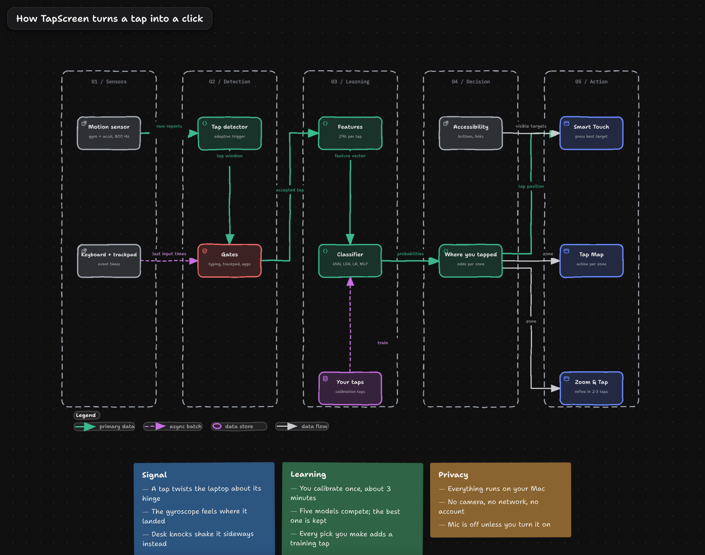

# TapScreen

Tap your MacBook's display and it clicks. No extra hardware.

TapScreen listens to the motion sensor inside Apple Silicon MacBooks. A tap on the lid twists the laptop slightly,
and a small model trained on your own taps works out where on the screen you tapped. It then presses the button
under your finger, or runs whatever you assigned to that part of the screen.

It is not a capacitive touchscreen: it cannot track a moving finger, drag, or see two fingers. It answers one
question per tap, very well: where was it?



An interactive version of this diagram (zoom, trace a path, light and dark) is in
[`docs/architecture.html`](docs/architecture.html).

## Download

1. Download **TapScreen-macOS.zip** from the [latest release](https://github.com/ardacanuckan/TapScreen/releases/latest).
2. Unzip it and move **TapScreen.app** to Applications or your Desktop.
3. Follow the [install guide](docs/GUIDE.md). It takes about 5 minutes, including calibration.

Needs an Apple Silicon MacBook with a motion sensor (M2 or later, or a 14"/16" M1 Pro/Max) on macOS 14 or later.
The M1 MacBook Air and 13" M1 MacBook Pro have no motion sensor.

## What a tap can do

| Mode | What happens |
|---|---|
| **Smart Touch** | Finds the button, link or field where you tapped (through Accessibility) and presses it. |
| **Tap Map** | You choose what each part of the screen does: open an app, a website or a file, play music, switch desktops, press what's under your finger. |
| **Zoom & Tap** | Each tap zooms into the part of the screen you chose; after two or three taps it clicks. Reaches any point. |

Turn it on and off in the app or with **⌃⌥T** from anywhere. When it's off, the sensors stop.

## How well it works

Accuracy depends on your Mac, how you sit and how you tap, so TapScreen measures it on your own data and shows it
in the Model tab. On the author's M4 MacBook Air, used on the lap with soft taps, it picked the right zone of a
4×3 grid 78% of the time and was 26 mm off on average. Rows (top/middle/bottom) were right 90% of the time,
columns 82%. Smart Touch turns that into exact clicks by snapping to the nearest real button.

What helps most: crisp light taps, more calibration taps, and calibrating where you actually use the laptop.

## How it works

1. **Sensor.** The accelerometer and gyroscope (`AppleSPUHIDDevice`, about 800 readings a second) are read through
   IOKit. This needs Input Monitoring, not root.
2. **Detection.** A tap shows up as a short burst of twist. A 160 ms window is cut around it. Taps that coincide
   with typing, clicking, trackpad use, switching apps or moving the lid are thrown away.
3. **Features.** 296 numbers per tap: direction and timing of the twist, how the energy splits across axes,
   frequency bands, and the waveform itself, aligned on its peak and scaled by tap strength.
4. **Model.** k-nearest neighbours, shrinkage LDA, logistic regression, a small neural network and an ensemble
   are cross-validated on your taps every time you train. The best one is kept. Training takes 1-2 seconds.
5. **Decision.** The model gives a probability for each zone. Taps that look like nothing it has seen, or like
   the bumps recorded during calibration, are ignored.
6. **Action.** Smart Touch scores every visible button by how likely the tap was aimed at it. Tap Map runs the
   zone's action.

Everything runs on the Mac. No network, no account, no camera.

### What didn't work

These were measured on real hardware and are in [`tools/`](tools) if you want to repeat them:

- **Microphone.** The sound of the tap added nothing on top of the motion sensor, so mic fusion is off by default.
- **Ultrasonic sonar.** The speakers and mic carry 17-22 kHz tones well, and a moving finger is detectable, but
  not its direction or position.
- **Camera.** The built-in camera and Desk View cannot see a hand that is touching the screen.

## Build from source

Needs the Xcode Command Line Tools (`xcode-select --install`). No Xcode project.

```bash
git clone https://github.com/ardacanuckan/TapScreen.git
cd TapScreen
scripts/build.sh
```

This compiles with `swiftc`, signs the app and moves it to your Desktop (set `TAPSCREEN_DEST` to put it elsewhere).
`scripts/build.sh --no-install` only builds into `build/`.

```bash
scripts/test.sh                                              # tests on synthetic taps, no sensor needed
scripts/experiment.sh                                        # cross-validated experiments on your recorded taps
~/Desktop/TapScreen.app/Contents/MacOS/TapScreen --selftest  # 6 s sensor check
```

macOS ties Accessibility and Input Monitoring to the app's signature. With the default ad hoc signature every
rebuild needs the permissions again. To avoid that, create a code signing certificate named
`TapScreen Developer` once (Keychain Access → Certificate Assistant → Create a Certificate…, type Code Signing);
`build.sh` uses it when it exists.

| Path | What's in it |
|---|---|
| `Sources/Core` | Sensor reader, tap detector, features, settings and storage |
| `Sources/ML` | The learners and cross-validated training |
| `Sources/Touch` | Accessibility target search, clicks, keys and zone actions |
| `Sources/App` | The engine that turns a tap into an action, app lifecycle |
| `Sources/UI` | The app window, menu bar popover and on-screen overlays |
| `Tests` | Headless tests for the detector, features and learners |
| `tools` | Model experiments, sonar and camera feasibility tests |
| `docs` | Install guide and the architecture diagram |

Your data lives in `~/Library/Application Support/TapScreen`. `dataset.json` keeps every raw tap, so a better
model or a different grid can reuse old calibration.

## Credits

The motion sensor access and the idea come from [LidTap](https://github.com/harsha20599/lidtap) by Yemcube
([@yem.cube](https://www.instagram.com/yem.cube)), [yamete](https://github.com/chipcolate/yamete) and
[apple-silicon-accelerometer](https://github.com/olvvier/apple-silicon-accelerometer). TapScreen is a separate
implementation. LidTap's license asks for credit when you share work built on it, and approval before any
commercial use.

TapScreen reads a sensor Apple doesn't document, so a macOS update could break it. Tap gently: pressing hard on a
display can damage it.
